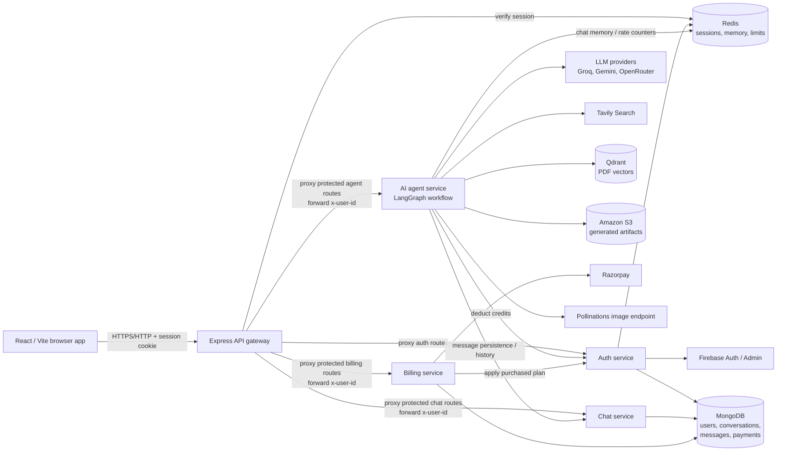
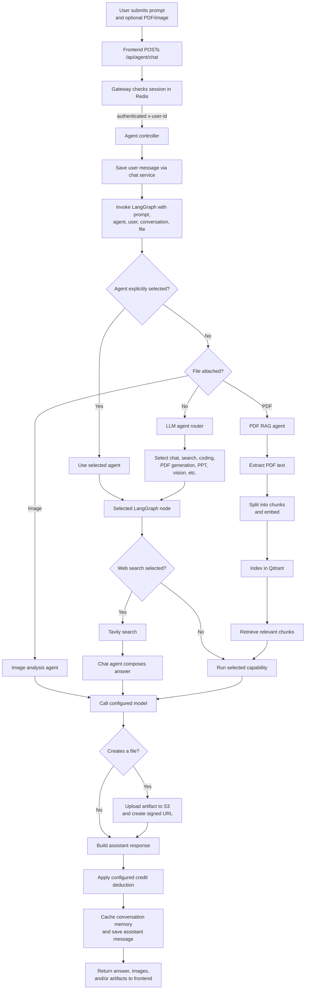
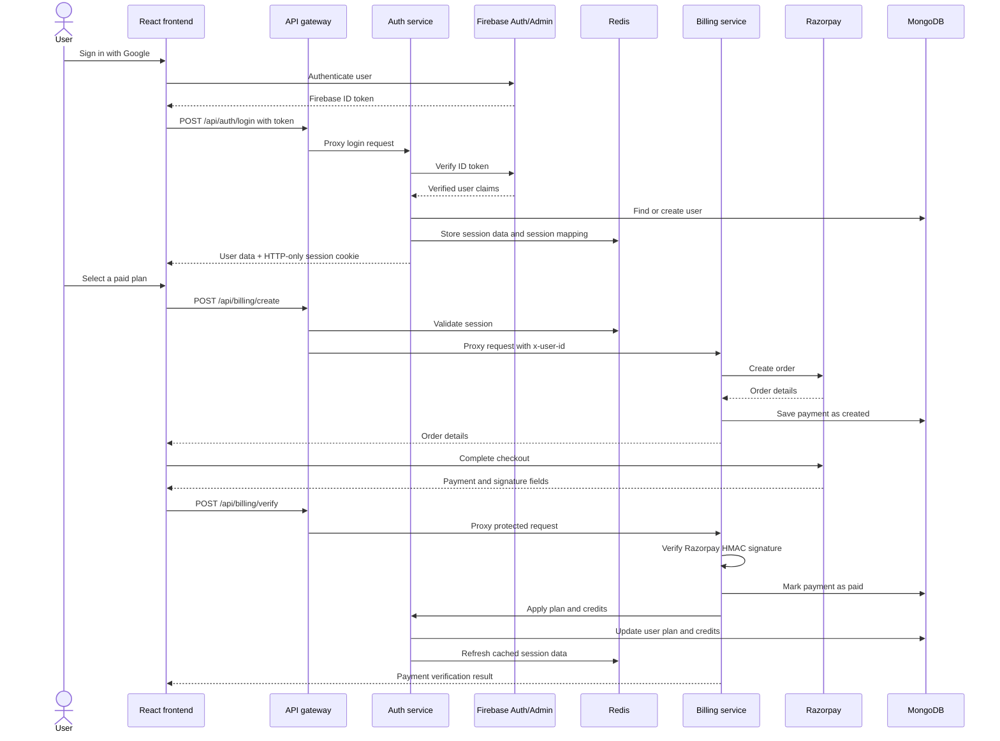

# CortexAI Architecture

This document describes the runtime components and the main authentication, agent, and payment flows visible in the current implementation.

## System architecture

### Component responsibilities

| Component | Responsibility |
| --- | --- |
| React/Vite frontend | Google sign-in UI, conversations, chat messages, file uploads, billing UI, and artifact links. |
| Express gateway | CORS and request logging, cookie-based session lookup, and routing to backend services. For protected routes it forwards the user ID in `x-user-id`. |
| Auth service | Firebase ID-token verification, user creation, Redis session management, credit deductions, and plan updates. |
| Chat service | MongoDB persistence for conversations and messages. |
| Agent service | Multipart upload handling, LangGraph routing, calling AI/search/retrieval tools, chat-memory caching, request limits, and artifact generation. |
| Billing service | Razorpay order creation, signature verification, payment persistence, and requesting plan updates from auth. |
| Redis | Shared session storage; agent chat-memory cache and per-agent request counters. |
| MongoDB | User, conversation, message, and payment documents. |
| Qdrant / S3 | Vector retrieval for PDF Q&A and storage of generated downloadable artifacts. |

## Agent request flow

### Notes on routing and persistence

- An explicit agent selection is used directly. In automatic mode, files are routed by MIME type before the LLM router is asked to classify a prompt.
- Search is a two-step path: search results are passed to the chat agent, which generates the answer.
- PDF upload analysis uses retrieval-augmented generation: extracted text is chunked, embedded, indexed in Qdrant, and searched for relevant context.
- The agent controller stores the user message before invoking the graph, then updates agent memory and persists the assistant response through the chat service.
- Agent request limits and chat memory use Redis. Current request limits are per-agent counters with a one-minute expiry.

## Authentication and payment flows

## Service routes

The gateway exposes these application routes:

| Route | Method | Gateway protection | Destination |
| --- | --- | --- | --- |
| `/api/auth/login` | `POST` | Not session-protected | Auth |
| `/api/auth/logout` | `GET` | Not session-protected | Auth |
| `/api/me` | `GET` | Session required | Gateway |
| `/api/chat/create-conversation` | `GET` | Session required | Chat |
| `/api/chat/get-conversations` | `GET` | Session required | Chat |
| `/api/chat/update-conversation` | `POST` | Session required | Chat |
| `/api/chat/save-message` | `POST` | Session required | Chat |
| `/api/chat/get-messages/:conversationId` | `GET` | Session required | Chat |
| `/api/agent/chat` | `POST` | Session required | Agent |
| `/api/billing/create` | `POST` | Session required | Billing |
| `/api/billing/verify` | `POST` | Session required | Billing |

The agent service also calls the chat and auth services directly for message persistence, history retrieval, and credit deductions. These internal service URLs are configured with environment variables.

